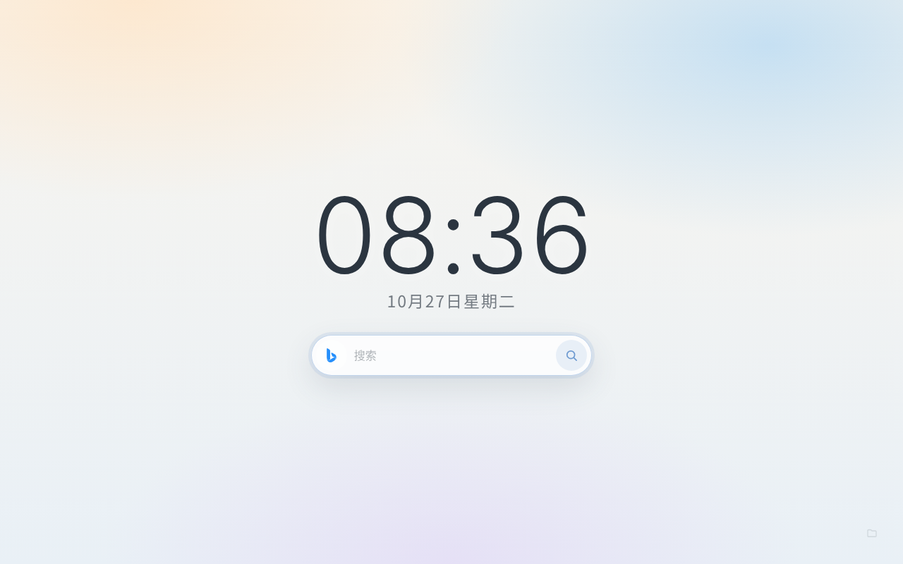

# 晨雾起始页

一个给 Microsoft Edge 用的新标签页：晨雾浅色背景、大时钟、安静搜索，收藏夹几乎隐形。

没有框架、没有构建工具、没有压缩代码。改完保存，刷新新标签页就能看到。



## 安装

### 从 Edge 加载项商店安装

公开上架审核通过后，可以直接从 Microsoft Edge 加载项商店安装。商店链接会在通过审核后补充到这里。

### 从 GitHub 安装

1. 打开 [最新版本](https://github.com/MAS-W-415/morning-haze-startpage/releases/latest)，下载 `morning-haze-startpage.zip`
2. 解压到一个长期保留的目录，例如 `D:\Startpage`
3. 打开 Edge，地址栏输入 `edge://extensions`
4. 打开“开发者模式”
5. 点“加载解压缩的扩展”，选择 `D:\Startpage`
6. 允许扩展读取收藏夹
7. 如果装了 Bonjourr 或其他新标签页扩展，建议先停用
8. 打开一个新标签页

> 也可以直接双击 `index.html` 查看页面，但没有扩展权限，收藏夹会显示备用链接。

### 从源码开发

```bash
git clone https://github.com/MAS-W-415/morning-haze-startpage.git
```

然后在 `edge://extensions` 中加载这个文件夹。

## 更新

### 商店版

Edge 会自动更新。也可以打开 `edge://extensions`，点扩展卡片上的“更新”。

### GitHub 版

1. 下载新的 `morning-haze-startpage.zip`
2. 解压并覆盖原来的目录
3. 回到 `edge://extensions`，点“重新加载”
4. 重新打开新标签页

不要把商店版和 GitHub 解压版装在同一个人 Edge 配置文件里，它们会同时争抢新标签页。

## 功能

- 晨雾浅色背景，大时钟 + 中文日期
- Bing / Google 搜索，点击左边图标打开引擎菜单
- 搜索在**新标签页**打开，起始页保持在原地
- 直接输入完整 `http://` / `https://` 网址，在当前页打开
- `F2` 在 Bing / Google 之间循环切换默认引擎
- 收藏夹平时几乎不可见，右下角只有一个小文件夹图标
- 点文件夹图标打开收藏夹浮层，按 `:` 直接查找书签
- 书签查找显示 Top 12，按使用次数和最近使用排序
- 自动 favicon，失败时显示首字母图标
- 收藏夹变化时自动刷新
- 书签在新标签页打开
- 键盘和鼠标都能完成所有操作

## 快捷键

### 搜索和引擎

| 按键 | 作用 |
|---|---|
| `F2` | 在 Bing / Google 之间循环切换默认搜索引擎 |
| `/` | 回到搜索框 |
| `Enter` | 在新标签页搜索 |
| `Esc` | 关闭菜单 / 清空搜索框 |
| `↑` / `↓` | 在引擎菜单里移动 |
| `Home` / `End` | 跳到引擎菜单第一项 / 最后一项 |
| `Space` | 引擎按钮聚焦时打开菜单；菜单项聚焦时选择 |

### 收藏夹

| 按键 | 作用 |
|---|---|
| `:` | 打开书签快速查找 |
| `Tab` | 可以聚焦到右下角收藏夹图标 |
| `Enter` | 打开收藏夹浮层 / 进入文件夹 |
| `↑ / ↓` | 在文件夹和书签之间移动 |
| `Backspace` | 返回上一级 |
| `Esc` | 返回上一级；在根目录时关闭浮层 |
| `Home` / `End` | 第一项 / 最后一项 |

### 书签快速查找

| 按键 | 作用 |
|---|---|
| `↑` / `↓` | 选择结果 |
| `Enter` | 在新标签页打开 |
| `Esc` | 关闭 |

鼠标也可以完成全部操作：

- 点搜索框左边的引擎图标打开引擎菜单
- 点菜单里的图标选择搜索引擎
- 点搜索按钮提交
- 点右下角文件夹图标打开收藏夹浮层
- 点文件夹、面包屑、返回或关闭
- 点收藏夹浮层右上角的放大镜打开书签查找
- 点书签打开链接

## 新标签页焦点和搜索

- Chromium 默认会把新标签页的键盘焦点放在地址栏
- 扩展无法直接抢走这个焦点，所以这里用 `focus.html` 先加载，再立即跳到 `index.html`
- 这样会尽量让搜索框直接拿到焦点
- 地址栏可能会显示 `chrome-extension://.../index.html`
- 如果光标仍然停在地址栏：点一下页面空白处，搜索框会获得焦点
- 也可以按 `Tab` 进入页面后，再按 `/` 聚焦搜索框
- 搜索会在新标签页打开，起始页保留
- 直接输入完整的 `http://` / `https://` 网址，仍在当前标签页打开

这是 Chromium 的浏览器行为，商店安装版也一样。

## 权限与隐私

扩展只申请两个权限：

- `bookmarks`：读取收藏夹栏，用来显示文件夹和书签
- `favicon`：通过 Chromium 的本地接口显示站点图标

另外通过 `chrome_url_overrides` 替换新标签页。

说明：

- 只读取收藏夹栏，不读取“其他收藏夹”
- 不会创建、修改、移动、删除或上传收藏夹
- 浏览器会显示“读取和更改你的收藏夹”，这是 Chromium 的固定权限文案，实际代码只读
- 使用次数和默认引擎只存在本机 `localStorage`
- 没有分析统计、广告、远程代码或第三方运行时库
- 搜索关键词只在你主动提交时发送给所选的搜索引擎

完整说明见 [隐私政策](PRIVACY.md)。

## 收藏夹说明

- 只读 Edge 的**收藏夹栏**
- 不读“其他收藏夹”
- 主页不显示磁贴，只保留右下角一个很淡的文件夹图标
- 点图标打开收藏夹浮层，顶层文件夹用行列表显示
- 子文件夹继续下钻，带面包屑和返回
- 没有散书签时，不会出现“常用”
- 如果以后出现散书签，会自动放进“未分类”，避免丢失
- 空文件夹自动隐藏
- 只显示 `http:` / `https:` 链接
- 书签标题用纯文本插入，不会执行 HTML
- 只读取收藏夹，不会修改、删除或上传你的收藏夹

### 书签查找

- 点收藏夹浮层右上角的放大镜，或按 `:`
- 空查询显示 **Top 12 书签**
- 有使用记录后，按**从这个起始页打开**的次数排序，次数相同按最近使用
- 第一次使用还没有记录时，按收藏夹栏原顺序取前 12 条
- 输入关键词会搜索**全部书签**，只渲染前 12 条匹配结果
- 结果上方会显示“共 N 条匹配，显示前 12 条”
- 结果会显示书签所在文件夹路径
- 打开次数和最近使用只存在本机 `localStorage`，不上传

如果收藏夹栏是空的，浮层里会显示“收藏夹栏是空的”，主页不会混入备用链接。

## 常改的地方

### 1. 加搜索引擎

打开 `js/config.js`，复制一项：

```js
{
    id: 'baidu',
    name: '百度',
    icon: 'assets/icons/baidu.svg',
    url: 'https://www.baidu.com/s',
    param: 'wd',
}
```

把图标放进 `assets/icons/`，菜单会自动多一项。

### 2. 改默认搜索引擎

`js/config.js`：

```js
defaultEngine: 'bing',
```

改成 `'google'` 就是默认 Google。

书签查找最多显示多少条，也在 `js/config.js`：

```js
finderLimit: 12,
```

### 3. 改备用链接

`js/config.js` 的 `fallbackLinks`：

```js
fallbackLinks: [
    { title: 'GitHub', url: 'https://github.com' },
]
```

备用链接只在“不是扩展环境”或“没有收藏夹权限”时显示。

### 4. 改颜色

`css/main.css` 顶部：

```css
:root {
    --bg: #eef2f5;
    --text: #26313c;
    --accent: #6f9bd1;
    --glass: rgba(255, 255, 255, 0.55);
}
```

- `--bg`：页面背景
- `--text`：主文字颜色
- `--accent`：强调色
- `--glass`：搜索框和浮层的玻璃背景

文件夹圆点在 `js/config.js` 的 `folderColors`。

### 5. 改时钟

`js/main.js` 里的 `updateClock()`：

```js
timeElement.textContent = `${hours}:${minutes}`;
dateElement.textContent = `${month}月${day}日${weekdays[now.getDay()]}`;
```

- 想显示秒：加 `const seconds = pad(now.getSeconds())`，再拼进去
- 想显示年份：在日期前加 `${year}年`
- 想改成 12 小时制：自己加 `AM/PM` 判断

时钟每秒更新一次：

```js
window.setInterval(updateClock, 1000);
```

## 文件说明

```text
manifest.json             Edge 扩展配置
focus.html                新标签页中转页
index.html                页面结构
css/main.css              全部样式
js/focus.js               中转页跳转
js/config.js              搜索引擎、查找数量、备用链接、文件夹颜色
js/bookmarks.js           收藏夹入口、文件夹浮层、书签查找、自动同步
js/main.js                时钟、搜索、引擎菜单、键盘
assets/icons/             Bing / Google / 扩展图标
assets/fonts/             Inter / Noto Sans SC 字体

docs/                     GitHub Pages 安装页和隐私页
store/                    商店文案、提交清单和商店素材
.github/workflows/        GitHub Actions 自动打包
PRIVACY.md                隐私政策源文件
THIRD_PARTY_NOTICES.md    第三方来源和许可证
```

## 开发与发布

1. 修改 `manifest.json` 里的版本号，例如 `1.0.1`
2. 更新 `CHANGELOG.md`
3. 提交并推送
4. 打 tag：

```bash
git tag v1.0.1
git push origin v1.0.1
```

GitHub Actions 会：

- 检查 `manifest.json` 和 JavaScript 语法
- 检查 tag 与 manifest 版本号是否一致
- 打包 `morning-haze-startpage.zip`
- 创建 GitHub Release

商店版本使用同一个 ZIP 上传。

GitHub Pages 建议设置为：

```text
Settings → Pages → Deploy from a branch → main → /docs
```

发布前把 `docs/config.js` 里的 GitHub 用户名、仓库名和商店链接填好。

## 给朋友的安装说明

商店版：

1. 打开商店链接
2. 点“获取”
3. 允许读取收藏夹
4. 如果新标签页没变化，去 `edge://extensions` 停用其他新标签页扩展
5. 打开新标签页

GitHub 版：

1. 下载最新 ZIP，解压到固定目录
2. `edge://extensions` → 开发者模式 → 加载解压缩的扩展
3. 选择解压后的文件夹
4. 允许读取收藏夹
5. 打开新标签页

如果打开新标签页后光标还在地址栏，点一下页面空白处即可。

## 许可与来源

- 本项目基于 [minimal-startpage-template](https://github.com/pedro-pablo/minimal-startpage-template)，MIT License
- 原模板版权：Copyright (c) 2019 pedro-pablo
- 本项目修改部分：Copyright (c) 2026 晨雾起始页 contributors
- Inter 字体：SIL Open Font License，见 `assets/fonts/LICENSE-Inter.txt`
- Noto Sans SC 字体：SIL Open Font License，见 `assets/fonts/LICENSE-NotoSansSC.txt`
- Bing / Google 图标属于各自品牌，仅用于标识搜索引擎，本项目与 Microsoft、Google 无隶属关系

许可证和第三方说明见 [LICENSE](LICENSE) 与 [THIRD_PARTY_NOTICES.md](THIRD_PARTY_NOTICES.md)。

## 相关链接

- GitHub 仓库：https://github.com/MAS-W-415/morning-haze-startpage
- 最新版本：https://github.com/MAS-W-415/morning-haze-startpage/releases/latest
- 问题反馈：https://github.com/MAS-W-415/morning-haze-startpage/issues
- 安装页：https://MAS-W-415.github.io/morning-haze-startpage/
- 隐私政策：https://MAS-W-415.github.io/morning-haze-startpage/privacy.html
- Edge 加载项商店：上架审核通过后补充
